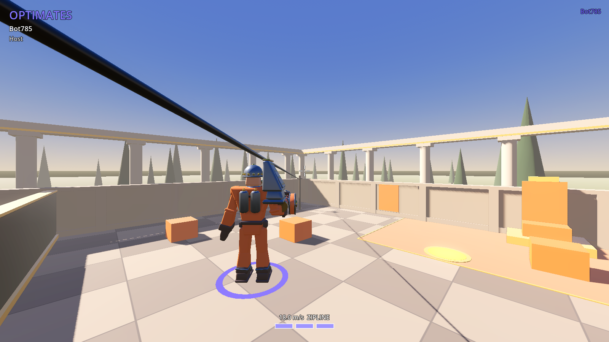

# BRUTUS

Командный шутер от третьего лица с MOBA-механиками (линии, крипы, трон). Godot 4.7, GDScript, сеть — ENet + [netfox](https://github.com/foxssake/netfox) (предсказание на клиенте, откат и сверка с сервером).

- Дизайн: [`docs/design.md`](docs/design.md)
- Текущий план: [`docs/plans/2026-11-11-g1-godot-port.md`](docs/plans/2026-11-11-g1-godot-port.md)
- Код под Unreal (вехи M1–M2) остался в истории: ветки `m1-movement-shooting`, `m2-heroes`.



## Запуск

1. Скачать **Godot 4.7.x** (обычная версия, не .NET): <https://godotengine.org/download/archive/4.7.2-stable/> (или текущая 4.7.x на <https://godotengine.org/download>). Это один файл, установка не нужна.
2. Запустить Godot → *Import* → выбрать `project.godot` в папке репозитория → *Import & Edit*. Первый импорт занимает до минуты.
3. **F5** (*Run Project*). Откроется главное меню.

### Игра по сети

- **Host** — поднять игру на своём компьютере (порт по умолчанию 7777, UDP) и играть самому. Друзьям нужен ваш IP (в локальной сети — адрес вида `192.168.x.x`; через интернет — внешний IP и проброс UDP-порта 7777 на роутере, либо Hamachi/ZeroTier/Tailscale).
- **Join** — ввести `IP:порт` хоста (например `192.168.1.10:7777`) и нажать *Join*.
- Ник вводится в поле *Nickname* и запоминается. Команды распределяются автоматически: новый игрок попадает в меньшую партию — **Оптиматы** (синие, база на −X) или **Популяры** (оранжевые, база на +X).
- Два окна на одной машине: в редакторе *Debug → Customize Run Instances…* → 2 экземпляра, затем F5; в одном *Host*, в другом *Join* `127.0.0.1:7777`.

### Выделенный сервер

```bash
godot --headless --path . -- --server            # порт 7777
godot --headless --path . -- --server --port 7000
```

`godot` — путь к исполняемому файлу Godot (на Windows, например, `Godot_v4.7.2-stable_win64_console.exe`), команда выполняется в папке репозитория. Сервер без окна и без своего игрока; игроки подключаются через *Join*. Другие ключи командной строки (после `--`): `--host`, `--connect IP[:PORT]`, `--name NICK`, `--port N`, `--quit-after SEC`, `--bot [moves|zipline]`, `--screenshot PATH [--shot-view player|overview|base0|base1|zipline] [--shot-delay SEC]` — описаны в `src/net/session.gd`.

## Тесты и проверки

```bash
godot --headless --path . --import                         # один раз после git pull (кэш class_name)
godot --headless --path . -s res://tests/run_tests.gd      # юнит-тесты src/sim, код выхода 0 = зелёно
tools/net_smoke_test.sh                                    # сервер + 2 бота в отдельных процессах, ~20 с
LAG_MS=60 LOSS=2 tools/net_smoke_test.sh                   # то же через UDP-прокси с задержкой и потерями
xvfb-run -a godot --path . --rendering-driver opengl3 --rendering-method gl_compatibility \
  -- --screenshot docs/screenshots/player.png               # скриншот (без экрана — через Xvfb)
```

Смоук-тест проверяет по логам: клиенты подключились и попали в разные партии, бот-бегун сместился на сервере больше чем на 5 м, сервер видел рывок, скольжение, двойной прыжок и проезд по зиплайну, нигде нет `SCRIPT ERROR`.

## Структура

- `src/sim/` — игровая математика без сцен (стамина, движение, зиплайны, история хитбоксов, лучи, видимость команды, партии); тесты в `tests/`.
- `src/player/` — игрок под откатом netfox (`player.gd`), ввод (`player_input.gd`), камера, внешний вид, бот для тестов.
- `src/net/` — сессия и командная строка (`session.gd`, автозагрузка `Session`), спавн игроков и выбор партии, сцена матча.
- `src/arena/` — серая арена из кода (раскладка, оформление баз, окружение, небо).
- `src/ui/` — HUD, главное меню, меню паузы. `scenes/` — сцены. `tools/` — смоук-тест, UDP-прокси с задержкой, скрипты рендера.

## Управление

WASD — движение, мышь — обзор, Space — прыжок (второй в воздухе тратит заряд стамины), Shift — рывок (заряд стамины), Ctrl/C — скольжение (на бегу от 5 м/с) или присед, E — зацепиться за зиплайн / отцепиться (прыжок тоже отцепляет), Esc — меню (курсор), клик — вернуть мышь в игру. Стамина: 3 заряда, по 2.5 с на заряд.

В Godot-версии пока есть только движение (веха G1-B1); ЛКМ (стрельба) и способности героев ниже — описание Unreal-версии, их перенос — следующие задачи плана.

Способности героя: Q — первый скилл, F — второй скилл, R — ульта.

### Клавус

- ЛКМ — гвоздомёт (быстрый, точный, слабые попадания).
- Q — липкая граната: прилипает к первому, во что попала (к герою — цепляется), взрывается через 2 с; урон по врагам в радиусе 3.5 м, стены и щиты укрывают.
- F — щит: стена 3×2 м перед героем, держит выстрелы и снаряды обеих команд, 400 HP (урон наносят только враги), стоит 8 с.
- R — «Таран»: рывок вперёд на 0.6 с; враги на пути получают урон, отлетают и оглушены на 0.5 с.

### Маллеус

- ЛКМ — дробовик: 8 дробин по 9 урона, разброс 5°.
- ПКМ — удар молотом (0.9 с): 75 урона всем врагам в сфере r 120 в 150 см перед собой.
- Q — прыжок с ударом (14 с): подскок, при приземлении 70 урона в радиусе 400 (к краю до 50%) и замедление 30% на 2 с.
- F — цепь (16 с): первый враг на линии прицела до 1500 см получает 40 урона и притягивается на 150 см перед Маллеусом (снимается с зиплайна и скольжения).
- R — ярость (75 с): на 10 с ×1.3 размер (вместе с хитбоксом, если хватает места), лечение 300, получаемый урон ×0.7.
